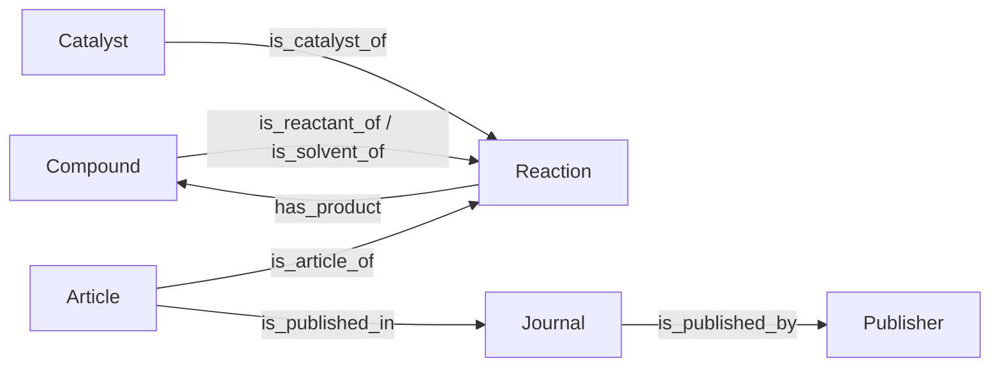

# Reaction cleaning and graph construction

## Cleaning rules

The example uses the structural, compound-name, unit, bounds-checking, and single-step scoring functions in `data_processing/` and `path_recommendation/scoring.py`. Source reaction identifiers are retained so that cleaned values remain linked to the original reaction and article.

| Stage | Purpose and handling |
|---|---|
| Structure | Normalize field names; represent unavailable required values as `unknown` |
| Compound names | Map equivalent names to common compounds so that adjacent reactions connect through the same intermediate |
| Units | Normalize supported temperature, pressure, and time expressions |
| Performance | Parse supported conversion, yield, and selectivity expressions as percentages |
| Bounds | Check percentage ranges and consistency across products |
| Reaction checks | Apply the supplied structural and chemical checks |
| Scoring | Recalculate single-step scores and retain source `singleReaction` flags |

The prompts can retain product amounts or production rates in `yield` when no percentage yield is available. Original expressions and units remain as text in `data/extracted_reactions.json` for source tracing and manual inspection. Non-percentage yield values receive no further numerical processing. Automatic scoring uses valid numerical percentages; yield values that cannot be converted receive no yield-dependent contribution. Missing numerical performance values use `unknown` placeholders and are assigned zero in the corresponding scoring variables.

`outputs/performance_review.json` lists unit-bearing values with their cleaned counterparts for inspection. Future updates will distinguish percentage yield, product amount, and production rate in separate fields, with explicit units, normalization bases, and source context, to improve comparison of reported performance.

## Demonstration graph

The sample retains identifiers from the paper's cleaned 471,436-reaction Neo4j graph. The 40 reactions are cleaned and scored again to construct the separate demonstration graph.



| Label | Key | Count |
|---|---|---:|
| Reaction | ID | 40 |
| Article | article_ID | 40 |
| Compound | name | 18 |
| Catalyst | catalystName + reactionID | 40 |
| Journal | journalName | 23 |
| Publisher | publisher | 4 |

Conversion is stored on reactant relationships because it describes consumption of a particular starting compound. Yield, selectivity, Faradaic efficiency, and main-product flags are stored on product relationships because they describe formation of a particular product. Each product relationship also stores the reaction-level A score. Shared Compound nodes allow a product of one reaction to connect to the reactant of another.

Article, Journal, and Publisher relationships retain the literature source of each reaction. Publication links are recorded in `data/graph_metadata.json`. Source `singleReaction` flags are preserved. The article full texts are supplied separately in `data/fulltexts/`.

## Neo4j demonstration

The dump uses **Neo4j Community 5.20.0 and Java 17**. Install these separately; `requirements.txt` supplies the Python driver. Use a dedicated Neo4j instance for this demonstration.

Choose either [restoring the supplied dump](#restore-the-graph) to use the prepared sample graph directly, or [building from the cleaned records](#build-a-graph-from-the-cleaned-records) to reproduce its construction. Both approaches support the retrieval and scoring commands below.

### Restore the graph

Stop the instance before loading. From the package directory, run the command for your installation:

```powershell
$neo4jHome = 'C:\path\to\neo4j-community-5.20.0'
& "$neo4jHome\bin\neo4j-admin.bat" database load neo4j --from-path="$PWD\data\neo4j"
```

On macOS or Linux:

```bash
/path/to/neo4j-community-5.20.0/bin/neo4j-admin database load neo4j --from-path="$PWD/data/neo4j"
```

Load into an empty instance. The directory argument contains `neo4j.dump`, and the database name is `neo4j`. Start the instance and complete its initial password setup in Neo4j Browser. If another server is running locally, select unused ports in the dedicated instance's `conf/neo4j.conf`, for example:

```text
server.bolt.listen_address=:7689
server.http.listen_address=:7476
```

### Score paths from an existing graph

`path_recommendation/scoring_and_ranking_example.py --source neo4j` reads the 40 sample reactions and connected CO2 + H2 → CO → methanol paths from Neo4j. It recalculates A1–A8 from reaction, catalyst, article, and performance properties, ranks the retrieved paths by A+B+C, and prints the calculation for the highest-ranked sample path.

The sample CSV supplies reaction IDs; scoring values come from the database. Queries are read-only, and results are saved in `outputs/neo4j_scoring/`. Stored product scores are checked against the recalculated values used for ranking.

Use an existing CatKG graph containing the sample reactions and their article and catalyst links, or restore the supplied demonstration dump. Set your instance's connection values below.

In the Python environment containing the dependencies in `requirements.txt`, set the connection variables. In PowerShell:

```powershell
$env:NEO4J_URI = 'bolt://localhost:7689'
$env:NEO4J_DATABASE = 'neo4j'
$env:NEO4J_USERNAME = 'neo4j'
$neo4jPassword = Read-Host "Neo4j password" -AsSecureString
$env:NEO4J_PASSWORD = [System.Net.NetworkCredential]::new('', $neo4jPassword).Password
python path_recommendation/scoring_and_ranking_example.py --source neo4j
```

On macOS or Linux, set the same variables in your shell:

```bash
export NEO4J_URI='bolt://localhost:7689'
export NEO4J_DATABASE='neo4j'
export NEO4J_USERNAME='neo4j'
read -rs -p 'Neo4j password: ' NEO4J_PASSWORD
export NEO4J_PASSWORD
python path_recommendation/scoring_and_ranking_example.py --source neo4j
```

Use your instance's actual URI and password. If `NEO4J_PASSWORD` is unset, the script prompts for it without echoing the input. `--uri`, `--database`, and `--username` can override the corresponding environment variables. Use `--no-auth` only for a database with authentication disabled. Connection credentials are kept outside the code package.

For the supplied graph, the expected result is **400 retrieved pairs**, with **284292 → 311263** ranked first at **3702.93**. The printed output includes the five highest-ranked paths, A1–A8 for both reactions, B1–B8, and C1–C2. `path_rankings.json` contains the complete ranking; `verification.json` contains the database reaction count, sample count, retrieved-pair count, and stored-score comparison. The query and reconstruction functions are in `path_recommendation/recommendation.py`. No APOC plugin is required.

### Validate the restored demonstration graph

To compare all 400 pairs in the dedicated demonstration database with the offline workflow, run:

```shell
python process_reactions_and_rank_paths.py
python data_processing/neo4j_graph.py
```

This separate validation tool checks the 40-reaction demonstration scope and uses the parameterized queries in `path_recommendation/queries.py`. Successful execution reports **`offline_score_match: true`** and writes results to `outputs/neo4j_validation/`.

### Build a graph from the cleaned records

To populate an empty demonstration database from the generated node and relationship tables, run:

```shell
python process_reactions_and_rank_paths.py
python data_processing/neo4j_graph.py --import-demo
```

The importer accepts an empty database or this dedicated 40-reaction graph. To export it, stop the instance and choose a new dump directory:

```powershell
& "$neo4jHome\bin\neo4j-admin.bat" database dump neo4j --to-path="C:\path\to\new-sample-dump"
```

The graph contains 40 reactions, 40 articles, 40 catalysts, 18 compounds, 23 journals, and 4 publishers. Article full texts are provided separately in `data/fulltexts/`. The graph schema above describes the relationships and properties.
